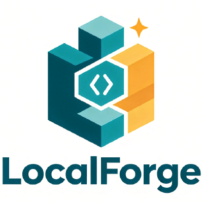

<p align="center">
  
</p>

<h1 align="center">LocalForge</h1>

<p align="center">
  <b>纯浏览器端的本地文件工具箱</b> —— 压缩、解压、格式转换、媒体转码、PDF 处理、P2P 直传，<br/>
  <b>全部在本地完成，文件不上传任何服务器。</b>
</p>

<p align="center">
  <a href="https://github.com/javaeer/local-forge/actions/workflows/ci.yml"></a>
  <a href="LICENSE"></a>
  <a href="https://github.com/javaeer/local-forge/releases"></a>
  <a href="http://forge.freedev.app/"></a>
  
  
</p>

> **LocalForge** 受 ezyzip.pro 启发，在本地浏览器里提供同类文件处理能力并做了扩展：
> 没有后端、没有上传、没有追踪。文件在你自己的设备里被 zip.js / libarchive.js / ffmpeg.wasm 处理完毕即销毁。

---

## 在线体验

**[本地工坊](http://forge.freedev.app/)** —— Your files never leave your browser.

---

## 功能矩阵

| 分类 | 能力 | 实现 |
|---|---|---|
| **ZIP 工具箱** | 压缩为 ZIP（AES-256 密码、分卷拆分、压缩级别）／解压（含加密）／**分卷 ZIP 解压（多卷自动合并）**／多归档合并／格式互转 | [@zip.js/zip.js](https://github.com/gildas-lormeau/zip.js) 2.15 |
| **创建归档** | ZIP / TAR / TAR.GZ（自研可靠写入器，正确处理嵌套路径） | 自研 `writers.js`（USTAR） |
| **解压 / 提取** | RAR / 7Z / TAR / ISO / APK / DMG / WIM / DNG 等 200+ 格式；**分卷 ZIP 合并解压** | [libarchive.js](https://github.com/libarchive/libarchive.js) 2.0 (WASM) |
| **媒体转换** | MP4↔WebM↔MOV、MP4→MP3、WAV↔MP3、降码率压缩；**支持从 ZIP 内提取媒体** | [@ffmpeg/ffmpeg](https://github.com/ffmpegwasm/ffmpeg.wasm) 0.12（多线程优先 → 单线程回退 → CDN） |
| **图片** | PNG / JPG / WEBP 互转、有损压缩（TinyPNG 同款 PNG 量化保透明）、**改尺寸（等比/精确/填满）**、**文字水印（9 宫格 + 平铺）**、本地预览 | Canvas API + [upng-js](https://github.com/photopea/UPNG.js) |
| **批处理队列** | 一次拖入多份文件，套用同一操作 + 预设（网页优化 / 极限压缩 / 去 EXIF / 改尺寸 / 水印 / PDF 瘦身 / 打包），串行执行、逐项进度、可取消、结果可打包 ZIP | 复用各引擎，`src/lib/batch.js` |
| **文档转换** | Markdown → PDF / HTML（自带零依赖解析器）；含中日韩时 PDF 自动切换 canvas 渲染通道，无需内嵌字体 | 自研 `docconvert.js` + pdf-lib |
| **PDF** | 重压缩（内嵌图像重压 + 对象流去重）／**逐页预览（pdf.js 本地渲染）／合并多个 PDF／拆分为单页** | [pdf-lib](https://github.com/Hopding/pdf-lib) + [pdfjs-dist](https://github.com/mozilla/pdf.js) |
| **分享 / 安全** | WebRTC P2P 直传（手动 SDP 信令，无后端）；ZIP 密码字典恢复；归档修复 | WebRTC / 本地引擎 |
| **PWA / 离线** | 可安装（manifest + Service Worker）；**按需预缓存 WASM 内核**，断网也能用；缓存策略：外壳 network-first、内核 cache-first、静态资源 stale-while-revalidate | 自研 `public/sw.js` |
| **多语言** | 中文 / English / 日本語 / 한국어 / Español 五语界面，自动检测系统语言 + 持久化 | 零依赖 i18n 内核 `src/lib/i18n.js` |

> **关于 7Z / ISO / XZ / ZST / BZ2 的「创建」**：这些格式需要原版专有的 WASM 编码模块（网页端不可得），
> 本项目**不伪造**其创建能力——`createArchive` 对不支持的格式会明确报错并建议改用 ZIP / TAR / TAR.GZ。
> 但其**解压 / 提取**由 libarchive.js 完整覆盖，可放心使用。

---

## 快速开始（本地开发）

```bash
corepack enable          # 启用 pnpm（推荐；本项目用 pnpm 锁文件）
pnpm install
pnpm dev                 # 开发服务器 http://localhost:5173
pnpm build               # 生产构建到 dist/
pnpm preview             # 预览构建产物（默认 http://localhost:4173）
```

> 媒体转换依赖 ffmpeg 多线程内核，需要跨源隔离头（`COOP/COEP`）。
> 开发服务器已在 `vite.config.js` 的 `server.headers` / `preview.headers` 中配好；
> 生产部署见下方「部署」。若页面未启用跨源隔离，内核会自动回退到单线程，功能不变、仅转码稍慢。

## 端到端测试

```bash
pnpm test:e2e                # 基础归档能力（默认 http://localhost:5173，可用 BASE_URL 覆盖）
pnpm test:e2e:layout         # 布局/导航
pnpm test:e2e:features       # PWA / i18n / 跨工具工作流 / 历史筛选
pnpm test:e2e:offline        # 离线内核按需预缓存（SW 协议）
pnpm test:e2e:largefile      # 大文件流式读取 + 体积门禁
pnpm test:e2e:progress       # 阶段进度模型
pnpm test:e2e:batch          # 批处理队列
pnpm test:e2e:imagepro       # 图片改尺寸 / 水印
pnpm test:e2e:doc            # Markdown → PDF / HTML
pnpm test:e2e:i18n           # 中日英韩西五语切换
pnpm report:kernels          # 内核体积报告（构建产物 vs 实际下载）
pnpm prune:infinityfree      # 生成 InfinityFree 兼容产物（剔除超限文件 + 专用 .htaccess）
```

测试基于 `puppeteer-core` + 真实 Chromium 驱动浏览器。针对构建产物运行时，用
`BASE=http://localhost:4173 pnpm test:e2e:xxx`（`vite preview`）覆盖默认端口。

`pnpm test:e2e` 用 `puppeteer-core` + 真实 Chromium 驱动浏览器，覆盖：ZIP/TAR/TAR.GZ 创建（含嵌套路径）、
AES 密码加解密回环、无密码/错密码正确拒绝、格式转换、多归档合并、不支持格式报错、归档修复、嵌套 tar 提取、
**分卷 ZIP 合并解压**、**PDF 合并/拆分为单页**——全部通过且控制台零运行时错误
（`_e2e_media.mjs` / `_e2e_media2.mjs` 另覆盖媒体内核与 ZIP 内提取媒体）。

---

## 部署（让他人能在线访问）

LocalForge 是纯静态站点，构建产物即 `dist/`。任意静态托管均可，但**媒体转换的多线程内核需要跨源隔离头**，
因此推荐以下平台（均已提供配置文件）：

| 平台 | 配置 | 跨源隔离(多线程) | 注意 |
|---|---|---|---|
| **Vercel** | `vercel.json` | ✅ | 大文件上限宽松，可直接托管 32MB ffmpeg wasm |
| **Netlify** | `netlify.toml` | ✅ | 同上 |
| **Cloudflare Pages** | `public/_headers` + `public/_redirects` | ✅ | ⚠️ 免费版单文件上限 25MB，**32MB 的 ffmpeg wasm 无法上传**，会自动回退到 jsDelivr CDN（功能正常，运行时从 CDN 拉内核） |
| **Nginx / 宝塔** | 见 `deploy-fix/nginx.conf` | ✅ | 需手动配置 wasm MIME + COOP/COEP + SPA 回退 |
| **Apache / cPanel** | 见 `deploy-fix/.htaccess` | ✅ | 同上 |
| **GitHub Pages** | 需自行加 `base` 并在 Actions 注入 `COOP/COEP` 头 | ⚠️ 默认无 | 未配置跨源隔离时回退单线程内核；GitHub Pages 不易自定义响应头，建议优先前三者或自定义域名 + Cloudflare |
| **InfinityFree** | `pnpm prune:infinityfree` | ⚠️ 不可用 | 单文件上限 10MB(JS 1MB) 且有禁用的 .htaccess 指令 → 见下方专节 |

所有配置文件都为 `/` 设置了 `Cross-Origin-Opener-Policy: same-origin` 与 `Cross-Origin-Embedder-Policy: require-corp`，
并配置 SPA 回退（`/* → /index.html`），确保 vue-router 深链接可用。

### 部署到 InfinityFree（免费主机）

InfinityFree 有**硬性单文件上限**（HTML/PHP/JS 1MB、其他 10MB），超限文件会被**静默删除**。
原始 `dist/` 中 `ffmpeg-core.wasm`(32MB) 等 5 个文件会阵亡，必须用裁剪版：

```bash
pnpm build
pnpm prune:infinityfree        # 生成 dist-infinityfree/（自动剔除超限文件 + 专用 .htaccess）
```

把 `dist-infinityfree/` 内容上传到 `htdocs/`。剔除的 ffmpeg / tesseract 内核会由代码内置的
**CDN 兜底链路**自动接管（首次使用需联网，之后浏览器缓存复用），PDF worker 亦有同等兜底。

> ⚠️ InfinityFree 禁用了 `Header` / `Expires` 指令（写了会整站 502），因此**无法开启跨源隔离**，
> 多线程 ffmpeg 不可用，媒体转换自动降级为单线程。仅建议用于学习/演示，
> 正式发布请优先 Vercel / Netlify / Cloudflare Pages。

---

## 媒体内核策略（适配不同托管环境）

ffmpeg 内核按需加载，支持三种策略，通过 URL 参数或持久化配置切换：

| 策略 | 行为 | 适用场景 |
|---|---|---|
| `auto`（默认） | 本地MT → CDN-MT → 本地ST → CDN-ST | 常规部署，本地内核优先（省流量、离线可用） |
| `cdn` | **CDN-MT → 本地MT → CDN-ST → 本地ST** | **有单文件上限的免费主机**：不占主机空间，多线程照常可用 |
| `st` | 直接单线程 | 诊断 / 无 SharedArrayBuffer 环境 |

切换方式（二选一）：

```
https://你的域名/?lf-core=cdn        # 访问一次即写入 localStorage，之后一直生效
```

```js
localStorage.setItem('lf-core', 'cdn')   // 或在控制台设置
```

> **重要**：`cdn` 策略下**多线程不会退化**——`@ffmpeg/util` 的 `toBlobURL` 会把 CDN 资源
> 转成同源 blob，因此不违反 `COEP: require-corp`，跨源隔离照常生效。
> 代价是首次加载需联网拉取约 32MB 内核（之后由浏览器缓存复用）。

### 一键部署

[](https://vercel.com/new/clone?repository-url=https://github.com/javaeer/local-forge)

导入仓库后，构建命令 `pnpm build`、输出目录 `dist` 即可（配置文件已包含）。
Netlify / Cloudflare Pages 直接连接仓库并选用 `pnpm build` + `dist` 同样开箱即用。

---

## 隐私与安全

- **关于 / 隐私协议页面**：站点提供独立的「关于」与「隐私协议」页面（页脚可达）。隐私协议已就第三方广告（Google AdSense 等）的数据收集、Cookie 与退出方式作出声明，为后续接入广告预留合规基础；实际接入广告前，页面不加载任何广告脚本、不收集数据。
- **零上传**：所有处理在浏览器内通过 WebAssembly 完成，没有任何文件离开你的设备。
- **零追踪**：无分析、无遥测、无第三方请求（除非回退到 jsDelivr 拉取 ffmpeg 内核）。
- **P2P 直传**：分享功能用 WebRTC 点对点传输，信令靠手动复制 SDP，不经中心服务器。
- 解析不可信归档/媒体仍有理论攻击面（zip bomb、路径穿越、内核解析漏洞），请勿用它处理来源不明的文件。
- 漏洞请按 [SECURITY.md](.github/SECURITY.md) 私密报告，**勿开公开 Issue**。

---

## 工程结构

```
src/lib/archive.js   通用归档引擎：extract / createZip / createArchive / convert / merge
src/lib/writers.js   可靠的 ZIP/TAR/TAR.GZ 写入器（USTAR，正确处理嵌套路径）
src/lib/media.js     ffmpeg 媒体转换封装（本地多线程优先，回退单线程 / CDN）
src/lib/pdf.js       PDF 重压缩
src/lib/formats.js   格式与压缩选项 + 完整工具目录
src/views/           Home / ZipCompress / ZipExtract / ArchiveTool /
                     MediaConvert / ImageConvert / PdfTools /
                     ShareFiles / PasswordRecovery / Repair /
                     About / Privacy
src/components/      DropZone.vue 拖拽上传 / AdSlot.vue 广告位预留（接 AdSense 用）
public/libarchive/   libarchive.js 的 worker 与 wasm（不被打包，置于 public）
public/ffmpeg/       ffmpeg 多线程内核（本地打包，离线可用）
public/ffmpeg-st/    ffmpeg 单线程内核（跨源隔离不可用时的回退）
```

---

## 路线图

- [x] ~~暗色 / 亮色主题切换~~（已上线，含侧栏/顶栏双布局）
- [x] ~~i18n（中英界面）~~（已扩展为中日英韩西五语）
- [x] ~~批量图片压缩队列与进度~~（已上线「批处理队列」，支持多种操作 + 预设）
- [x] ~~PWA 可安装 + 离线内核按需预缓存~~
- [x] ~~Markdown → PDF / HTML 文档转换~~
- [ ] 7Z / ISO 创建（待可行的开源 WASM 编码方案）
- [ ] 目录拖拽保留结构（webkitRelativePath）
- [ ] 接入 Google AdSense 等第三方广告（`AdSlot` 组件已预留，待申请广告账号后填充 `data-ad-client` / `data-ad-slot`）
- [ ] 更多媒体预设（GIF、HEVC、无损提取）
- [ ] 多端封装：Web-first + Capacitor（App）/ Tauri（桌面），复用同一套 WASM 引擎

欢迎通过 Issue / PR 参与，见 [CONTRIBUTING.md](CONTRIBUTING.md)。

---

## 致谢

> **声明**：LocalForge 是一个独立的开源项目，与 ezyzip.pro 无任何隶属、合作或背书关系；其名称仅在与「灵感来源」相关的语境下被引用。

- 灵感来自 [ezyzip.pro](https://ezyzip.pro/)；- 核心引擎依赖 [@zip.js/zip.js](https://github.com/gildas-lormeau/zip.js)、[libarchive.js](https://github.com/libarchive/libarchive.js)、[@ffmpeg/ffmpeg (ffmpeg.wasm)](https://github.com/ffmpegwasm/ffmpeg.wasm)、[pdf-lib](https://github.com/Hopding/pdf-lib)；
- 图标来自 [Bootstrap Icons](https://icons.getbootstrap.com/)。

## 许可证

[MIT](LICENSE) © LocalForge Contributors
